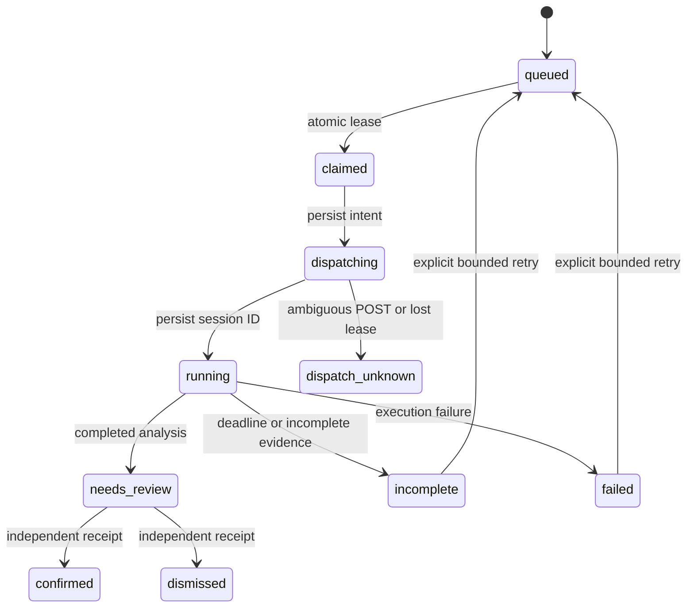

# State, memory, and failure handling

The database owns investigation identity, lifecycle, and evidence. A Devin
transcript is never the authoritative cache. SQLite supports the local demo;
PostgreSQL uses the same API and row locks for multiple workers.

## Two identities

An investigation fingerprint hashes the repository, CWE, relative path, symbol,
source, and sink. It excludes PR number, commit ID, and descriptive prose.
The analysis-context digest hashes the supplied full Git tree ID, environment
digest, policy version, analysis version, and the **entire normalized candidate**,
including its description. Their combination is unique. Different hypotheses
about the same symbol cannot inherit one another's dismissal just because their
CWE and path match.

Two PRs with identical tree and context reuse one investigation. A changed tree,
environment, policy, or analysis version creates a new investigation while keeping
the same finding fingerprint. Original evidence retains its original commit;
the new run records the new commit and links that historical investigation.

**This release deliberately uses whole-tree invalidation.** It does not build a
call graph or infer a complete dependency footprint. Even an unrelated tracked
file change invalidates the cache. Reusing results across different trees using
a proven dependency footprint belongs on the roadmap. The trusted planner must
derive the tree from the actual checkout and include relevant external settings
in `environment_digest`; fabricated caller-supplied hashes provide no assurance.

## State machine



`claim()` uses `BEGIN IMMEDIATE` on SQLite and a schema-row admission lock plus
`FOR UPDATE SKIP LOCKED` on PostgreSQL. `max_active_sessions` defaults to four;
all workers must use the same configured cap. Counting and admitting new work are
atomic across independent connections. Claimed, dispatching, running, and
ambiguous-dispatch jobs occupy slots. Polling/recovering an existing session is
allowed when the cap is full; it does not create another session. An ambiguous
dispatch deliberately retains its slot until an operator reconciles it.
An incomplete job whose remote cancellation was merely `accepted` or
`failed_or_unknown` also retains a slot and cannot be retried: a DELETE response
alone does not prove the remote session has stopped. Automated reconciliation
and a reviewed operator resolution endpoint remain roadmap work. Definitively
stopped/completed investigations without an uncertain-cancellation marker can
use the explicit bounded retry path.

Every mutation checks an unexpired lease token. The old worker cannot
overwrite progress after a different worker acquires the job.

An expired claim before dispatch is reclaimable. An expired running job resumes
polling the existing session ID and preserves its original deadline. An expired
dispatch with no persisted session ID becomes `dispatch_unknown`; the store does
not blindly issue a second paid session. Provider-side exactly-once creation and
automatic reconciliation are not claimed.

`release()` schedules the next poll and revokes the current lease. `checkpoint()`
persists partial results without marking the investigation complete. Evidence,
checkpoints, attempts, and link events are append-only through the application
API. A database administrator can still modify them: cryptographic tamper
evidence and storage retention locks are roadmap work.

## Independent verification and gate scope

An agent can finish only as `needs_review`, `incomplete`, `failed`, or
`dispatch_unknown`. Both an agent's positive finding and its "no finding" answer
need independent review. It cannot call `finish(..., "dismissed", ...)`.

The trusted verifier supplies `commit_sha`, `context_digest`, `artifact_sha256`,
and a verification `method`. The first two must match the investigated snapshot;
the artifact digest identifies evidence held by the verifier. The API must
authenticate this operation separately from worker/control access. Checking a
receipt's shape and hashes is not itself a reproduction or proof that it is true.

The gate is scoped to **submitted candidates only**:

| Condition | Decision |
| --- | --- |
| Any independently confirmed finding | `fail` |
| Any unfinished, failed, ambiguous, or unverified investigation | `blocked` |
| No candidates | `blocked` |
| Every submitted candidate independently dismissed | `pass` |

Every response includes `release_authorized: false`. The prototype neither
proves whole-repository coverage nor directly authorizes merges or deployments.
Binding an exhaustive scan manifest to required GitHub checks is roadmap work.

## Running the state tests

```sh
python -m unittest discover -s tests -p 'test_state.py' -v
```

To execute the same cases against PostgreSQL, set `TEST_POSTGRES_URL` to a
dedicated test database and install `psycopg[binary]`. Each test creates a uniquely
named schema and drops only that schema on completion. Skipped PostgreSQL tests
are not evidence of a successful PostgreSQL run.
